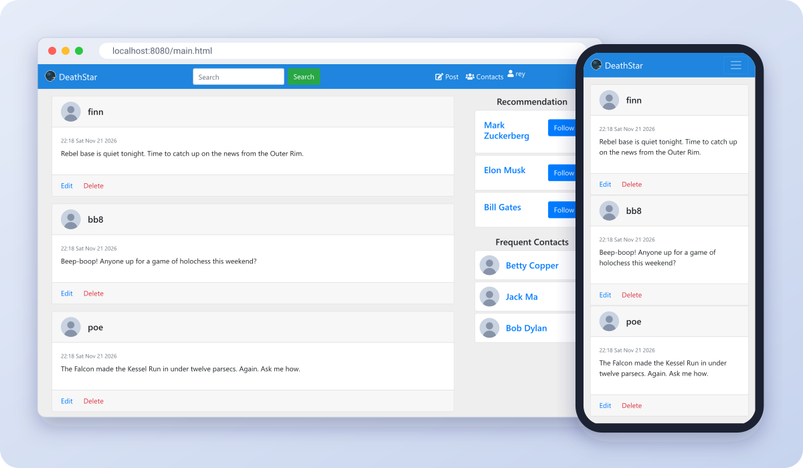

[](https://github.com/giis-uniovi/retorch-st-socialnetwork/actions)
[](https://sonarcloud.io/summary/new_code?id=my%3Aretorch-st-socialnetwork)

# RETORCH Social Network End-to-End Test Suite

This repository contains a vendored fork of the [DeathStarBench](https://github.com/delimitrou/DeathStarBench) Social Network
benchmark (C++ Thrift microservices behind an OpenResty gateway, in `📁 sut`) and an End-to-End test suite that is used as
demonstrator of the [RETORCH Framework](https://github.com/giis-uniovi/retorch). The suite exercises the social network UI and
APIs through Selenium and HTTP-based tests.

<p align="center">
  
</p>

## Prerequisites

- Java 8 or newer and Maven 3.8+ (to run the tests).
- Docker Engine / Docker Desktop with Docker Compose v2.
- Google Chrome (the UI tests drive a local Chrome through Selenium).
- Time and CPU for the first deployment: the images compile all the C++ services from source.

## SUT deployment

### Local deployment

`deploy.sh` (Linux / macOS) and `deploy.ps1` (Windows) create the `jenkins_network` Docker network if it does not exist, build the
images from `sut/` (slow the first time), start the stack with the project name `default` and wait up to 300 seconds until the
gateway serves the "Death Star" page.

| Linux / macOS | Windows (PowerShell) | What it does |
|---|---|---|
| `./deploy.sh` | `.\deploy.ps1` | Builds the images and deploys the SUT on the default port (8080) |
| `./deploy.sh --port 9090` | `.\deploy.ps1 -Port 9090` | Same, on another port |
| `./deploy.sh --no-build` | `.\deploy.ps1 -NoBuild` | Same, reusing the images already built |
| `./deploy.sh --down` | `.\deploy.ps1 -Down` | Tears down all containers and volumes |

(The first time on Linux / macOS: `chmod +x deploy.sh`.)

Once the SUT is ready it is at `http://localhost:<port>` (default http://localhost:8080).

### Jenkins CI deployment

The repository contains a `Jenkinsfile` and the lifecycle scripts in `.retorch/` that run the test suite in CI. They are
**generated** by the [RETORCH tool](https://github.com/giis-uniovi/retorch) from the `@AccessMode` annotations of the tests: do
not edit them by hand. After adding or changing tests, regenerate them with `orchestrate.ps1` (it needs the
`retorch-orchestration-*-standalone.jar` of the RETORCH tool in the repository root and Maven in the path).

- The pipeline runs on a Jenkins agent labelled `xretorch-agent` with Docker (Compose v2), Java and Maven.
- Every TJob deploys its **own** copy of the SUT (`--env-file .retorch/envfiles/<tjob>.env -p <tjob>`) on the external Docker
  network `jenkins_network`, runs the tests assigned to it (`mvn test -Dtest=... -DTJOB_NAME=<tjob> -DSUT_URL=<url>`) and
  tears the deployment down. TJobs of the same stage run in parallel.
- `.retorch/configurations/retorchCI.properties` holds the SUT particularities used by the generated scripts (how to wait for
  the SUT, where its sources are, its URL inside the Docker network). With `profiling=true` the pipeline also measures the
  CPU, memory and storage of every TJob and publishes the **usage profile** (`artifacts/usageprofile/usageprofile.html`, report
  "RETORCH Usage Profile"). The profiling tool is prepared by `.retorch/customscriptscode/custom-usageprofile` (it builds it from
  source, so the agent also needs Git); delete that file once a release publishes the jar.
- Custom commands of each lifecycle phase live in `.retorch/customscriptscode/`.

Particularities of this SUT:

- The SUT is vendored in `sut/`, so no fetch is needed; each TJob builds the images from those sources.
- The application is reached inside the Docker network at `http://<tjob>-nginx-thrift:8080`.
- Surefire is configured with `testFailureIgnore=true`: the build stays green when tests fail, so read the
  `Tests run: X, Failures: Y, Errors: Z` totals. The GitHub Actions workflow only triggers the SonarCloud scan.

## Running the tests

With the SUT deployed (see [Local deployment](#local-deployment)) run the whole suite from the repository root:

```bash
mvn test
```

To run a single class or method:

```bash
mvn test -Dtest=<TestClass>
mvn test -Dtest="<TestClass>#<testMethod>"
```

The target of the tests is resolved in this order: the `SUT_URL` system property, the `SUT_URL` environment variable and, if
none is set, the default local URL (`http://localhost:8080`). To test another deployment:

```bash
mvn test -DSUT_URL=http://localhost:9090
```

The CI pipeline also passes `-DTJOB_NAME=<tjob>` (the name of the TJob running the tests) together with `-DSUT_URL`.

The suite has Selenium UI tests (`giis.socialnetwork.e2e.functional.tests`) and HTTP API tests (`...tests.api`). Set `SELENOID_PRESENT`
to use a remote Selenium hub instead of a local Chrome. The social network is eventually consistent, so some tests poll until the
data shows up; if a single UI test fails unexpectedly, run its class again before suspecting a regression.

---

<p align="center">
  <a href="https://giis.uniovi.es/"></a>
</p>
